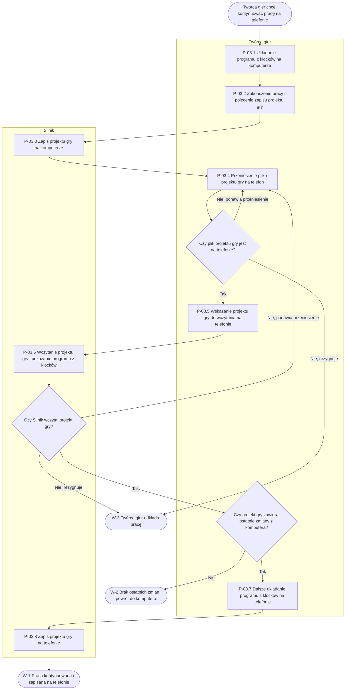

# P-03: Kontynuacja pracy na innym urządzeniu (TO-BE)

**Wersja:** 0.1 · **Właściciel:** Daryna K. · **Powiązane:** P-00 (AS-IS), P-01

## Cel procesu

Twórca gier zaczyna projekt gry na komputerze w pracowni szkolnej i dokańcza go w domu na telefonie, bez utraty dotychczasowej pracy (N-10).

## Wyzwalacz (zdarzenie początkowe)

Twórca gier kończy pracę nad projektem gry na komputerze w pracowni szkolnej i chce kontynuować ją w domu na telefonie (Pytania 8, 15; N-10).

## Uczestnicy (tory i pule)

Pula: kontynuacja pracy nad projektem gry na dwóch urządzeniach (komputer w pracowni szkolnej i telefon w domu).

| Tor | Rola w procesie |
|---|---|
| Twórca gier | Układa program z klocków, zleca zapis projektu gry, przenosi plik projektu gry na telefon, wskazuje projekt gry do wczytania i dalej układa program z klocków na telefonie. |
| Silnik | Zapisuje projekt gry lokalnie na urządzeniu, wczytuje zapisany projekt gry i pokazuje program z klocków w edytorze. |

Komputer w pracowni szkolnej i telefon nie są torami. Urządzenie wskazano w opisie każdego kroku.

## Wyniki (zdarzenia końcowe)

- **W-1:** Twórca gier kontynuuje projekt gry na telefonie i zapisuje go na telefonie.
- **W-2:** Projekt gry na telefonie nie zawiera ostatnich zmian z komputera i Twórca gier musi wrócić do komputera.
- **W-3:** Twórca gier odkłada pracę, bo plik projektu gry nie dotarł na telefon lub projekt gry nie wczytał się.

## Diagram

## Kroki

| Krok | Tor | Typ zadania | Opis | Wymagania |
|---|---|---|---|---|
| P-03.1 Układanie programu z klocków na komputerze | Twórca gier | zadanie użytkownika | Na komputerze w pracowni szkolnej Twórca gier układa program z klocków w projekcie gry, w tej samej aplikacji, której później używa na telefonie. | FR-21, FR-01, NFR-09 |
| P-03.2 Zakończenie pracy i polecenie zapisu projektu gry | Twórca gier | zadanie użytkownika | Przed opuszczeniem komputera Twórca gier kończy pracę i zleca zapis projektu gry. | FR-15 |
| P-03.3 Zapis projektu gry na komputerze | Silnik | zadanie systemowe | Silnik zapisuje projekt gry lokalnie na komputerze Twórcy gier, bez konta użytkownika. | FR-15, BR-03 |
| P-03.4 Przeniesienie pliku projektu gry na telefon | Twórca gier | zadanie ręczne | Twórca gier przenosi plik z zapisanym projektem gry z komputera na telefon. Sposób przeniesienia nie jest ustalony (w AS-IS: poczta lub komunikator, zob. P-00.7). | brak — do walkthrough |
| P-03.5 Wskazanie projektu gry do wczytania na telefonie | Twórca gier | zadanie użytkownika | W domu na telefonie Twórca gier otwiera aplikację i wskazuje zapisany projekt gry do wczytania. | FR-16 |
| P-03.6 Wczytanie projektu gry i pokazanie programu z klocków | Silnik | zadanie systemowe | Silnik wczytuje projekt gry z telefonu i wyświetla program z klocków w edytorze na ekranie telefonu. | FR-16, NFR-07, BR-03 |
| P-03.7 Dalsze układanie programu z klocków na telefonie | Twórca gier | zadanie użytkownika | Na telefonie Twórca gier dalej układa program z klocków, przeciągając klocki dotykiem ekranu. | FR-01, NFR-05 |
| P-03.8 Zapis projektu gry na telefonie | Silnik | zadanie systemowe | Na polecenie Twórcy gier Silnik zapisuje projekt gry z nowymi zmianami lokalnie na telefonie. | FR-15, BR-03 |

## Wyjątki i ścieżki alternatywne

| Wyjątek | Krok | Reakcja w TO-BE | Wymagania i źródło |
|---|---|---|---|
| Plik projektu gry nie dotarł na telefon | P-03.4 | Twórca gier ponawia przeniesienie pliku albo odkłada pracę (W-3). Zapisany projekt gry na komputerze pozostaje bez zmian. | brak — do walkthrough; N-10, N-11 |
| Projekt gry nie wczytuje się na telefonie | P-03.6 | Silnik nie pokazuje programu z klocków. Twórca gier ponawia przeniesienie pliku (P-03.4) albo odkłada pracę (W-3). | brak — do walkthrough; N-11. FR-13 dotyczy błędu w programie z klocków, a nie wczytania projektu gry. |
| Twórca gier zapomniał zapisać projekt gry przed opuszczeniem komputera | P-03.2 | Na telefonie projekt gry nie zawiera ostatnich zmian (W-2). Twórca gier wraca do komputera i powtarza proces od kroku P-03.2. | FR-15 (zapis następuje na polecenie Twórcy gier); N-10 |

## Zmiany względem AS-IS

| Krok AS-IS | Jak jest w P-00 | Jak ma być w TO-BE | Wymagania |
|---|---|---|---|
| P-00.5 Zapisanie pracy po lekcji | brak informacji | Zapis projektu gry jest osobnym krokiem: Twórca gier zleca zapis (P-03.2), a Silnik zapisuje projekt gry lokalnie (P-03.3). | FR-15, BR-03 |
| P-00.7 Próba dokończenia pracy w domu | Uczeń próbuje dokończyć w domu na telefonie pracę, która została na szkolnym komputerze. Plik wysłany pocztą lub komunikatorem często nie otwiera się tak, jak powinien (N-10, N-11). | Twórca gier wczytuje projekt gry w tej samej aplikacji na telefonie (P-03.5, P-03.6) i dalej układa program z klocków (P-03.7). Sposób przeniesienia pliku (P-03.4) pozostaje nieustalony. | FR-16, FR-21, FR-01; krok P-03.4: brak — do walkthrough |

## Otwarte pytania

- **Q-04:** W jaki sposób uczeń ma dokończyć w domu na telefonie pracę zaczętą na szkolnym komputerze (Pytania 8, 15)? Pytanie dotyczy kroku P-03.4. Dla tego kroku nie ma wymagania (brak — do walkthrough), więc Q-04 pozostaje otwarte.
- **BR-03 a krok P-03.4:** Reguła BR-03 (zapis wyłącznie lokalny, bez kont użytkowników) ogranicza ten krok. Projekt gry nie może zostać przeniesiony przez konto użytkownika, więc sposób przeniesienia musi opierać się na pliku przenoszonym przez Twórcę gier. Do ustalenia na walkthrough, czy ograniczenie jest akceptowalne dla klienta.
- **FR-17 a przeniesienie projektu gry:** Czy wyeksportowana gra (FR-17) może służyć do przeniesienia projektu gry? Dotyczy eksportu gry dla Odbiorcy gry, który nie może jej zmieniać (BR-01), a nie projektu gry do dalszej pracy. Pytanie do dodania do rejestru pytań otwartych.
- **Zapomniany zapis:** Czy po zapomnieniu zapisu (wyjątek w kroku P-03.2) Twórca gier ma dostęp do komputera w pracowni szkolnej po lekcji (Pytanie 6)? Brak odpowiedzi w dokumentach.