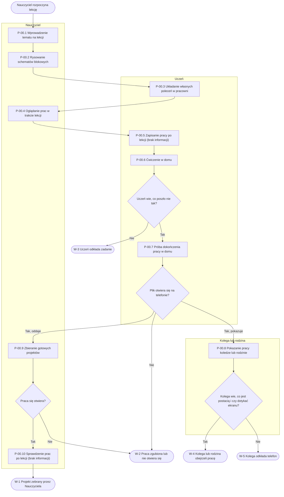

# P-00: Nauka podstaw programowania w szkole (AS-IS)

**Wersja:** 0.1 · **Właściciel:** Daryna M. · **Powiązane:** P-01, P-02, P-03

## Cel procesu

Uczeń poznaje podstawy algorytmów i programowania pod kierunkiem Nauczyciela, a gotowa praca trafia do Nauczyciela i zostaje pokazana innym.

## Wyzwalacz (zdarzenie początkowe)

Nauczyciel rozpoczyna lekcję wprowadzającą w podstawy algorytmów i programowania (Pytanie 5).

## Uczestnicy (tory i pule)

Pula: nauka podstaw programowania (szkoła i dom ucznia).

| Tor | Rola w procesie | Narzędzia |
|---|---|---|
| Nauczyciel | Prowadzi lekcję, tłumaczy kroki na przykładach i na tablicy, ogląda prace uczniów na ekranach i zbiera gotowe projekty. | Tablica, schemat blokowy, ekrany uczniów w pracowni szkolnej, pendrive, poczta |
| Uczeń | Układa własne polecenia w pracowni szkolnej, próbuje dokończyć pracę w domu na telefonie i pokazuje efekt innym. | Kilka programów na szkolnych komputerach, komputery stacjonarne lub laptopy, telefon, poczta, komunikator, pendrive |
| Kolega lub rodzina | Ogląda pracę ucznia na jego ekranie lub telefonie albo otrzymuje od niego plik. | Ekran ucznia, telefon, komunikator, plik |

## Wyniki (zdarzenia końcowe)

- **W-1:** Gotowy projekt został zebrany przez Nauczyciela.
- **W-2:** Praca ucznia zgubiła się lub nie da się jej otworzyć.
- **W-3:** Uczeń zniechęcił się i odłożył zadanie.
- **W-4:** Kolega lub rodzina obejrzeli pracę ucznia.
- **W-5:** Kolega odłożył telefon, bo nie wiedział, co robić w grze.

## Diagram

## Kroki

| Krok | Kto | Co robi | Narzędzie lub dokument | Problem (N-xx) |
|---|---|---|---|---|
| P-00.1 Wprowadzenie tematu na lekcji | Nauczyciel | Zaczyna od prostych przykładów z życia, np. kolejności kroków przy codziennej czynności (Pytanie 5). | Tablica | Uczniowie nie widzą od razu, jak takie kroki działają w prawdziwej grze (N-01). |
| P-00.2 Rysowanie schematów blokowych | Nauczyciel, Uczeń | Wspólnie rysują schematy blokowe na tablicy (Pytanie 5). | Tablica, schemat blokowy | Brakuje czegoś, dzięki czemu uczniowie od razu zobaczą działanie kroków w grze (N-01). |
| P-00.3 Układanie własnych poleceń w pracowni | Uczeń | Próbuje ułożyć własne polecenia na komputerze w pracowni szkolnej (Pytania 5, 6, 9). | Kilka programów na szkolnych komputerach, komputery stacjonarne lub laptopy | Większość programów działa tylko na komputerze, a instalowanie nowych programów bywa zablokowane (N-06). Uczniowie mylą warunek z pętlą i mają trudność ze zmienną (N-05, Pytanie 7). |
| P-00.4 Oglądanie prac w trakcie lekcji | Nauczyciel | Chodzi po pracowni i ogląda prace na ekranach uczniów (Pytanie 14). | Ekrany uczniów w pracowni szkolnej | Przy całej klasie jest to uciążliwe (Pytanie 14). Brak odpowiadającej potrzeby w sekcji „Potrzeby”. |
| P-00.5 Zapisanie pracy po lekcji | Uczeń | brak informacji | brak informacji | brak informacji |
| P-00.6 Ćwiczenie w domu | Uczeń | Próbuje wykonać ćwiczenia w domu, gdzie ma głównie telefon (Pytania 8, 9). | Telefon, ćwiczenia przygotowane pod komputer | Na małym ekranie trudno wykonać ćwiczenia (N-07). Nikt nie podpowiada, co poszło nie tak, więc uczeń się zniechęca i odkłada zadanie (N-08). |
| P-00.7 Próba dokończenia pracy w domu | Uczeń | Próbuje dokończyć w domu pracę, która została na szkolnym komputerze (Pytanie 15). | Telefon, plik wysłany pocztą lub komunikatorem | Praca zostaje na szkolnym komputerze, a w domu uczeń ma tylko telefon (N-10). Plik często nie otwiera się tak, jak powinien (N-11). |
| P-00.8 Pokazanie pracy koledze lub rodzinie | Uczeń, Kolega lub rodzina | Uczeń woła kolegów do swojego ekranu, pokazuje efekt na własnym telefonie albo czasem wysyła plik przez komunikator (Pytanie 13). | Ekran ucznia, telefon, komunikator, plik | Plik nie zawsze udaje się otworzyć na innym urządzeniu (N-11). Gdy nie wiadomo, co jest postacią i czy trzeba dotykać ekranu, koledzy odkładają telefon (N-12, Pytanie 16). |
| P-00.9 Zbieranie gotowych projektów | Uczeń, Nauczyciel | Uczeń przekazuje gotowy projekt, a Nauczyciel zbiera go na pendrive'ach albo przez pocztę (Pytanie 14). | Pendrive, poczta | Część prac się gubi lub nie da się jej otworzyć (Pytanie 14). Powiązana jest potrzeba N-11 (częściowo); osobnej potrzeby Nauczyciela dotyczącej zbierania prac w sekcji „Potrzeby” brak. |
| P-00.10 Sprawdzenie prac po lekcji | Nauczyciel | brak informacji | brak informacji | brak informacji |

## Punkty bólu

| Krok | Problem | Problem z karty projektu | Odpowiedź w TO-BE |
|---|---|---|---|
| P-00.1, P-00.2 | Uczniowie nie widzą od razu, jak kroki działają w prawdziwej grze (N-01). | „Brakuje wygodnego, mobilnego silnika, w którym początkujący stworzy własną grę i nauczy się podstaw algorytmów.” | FR-01, FR-10 |
| P-00.3 | Większość programów działa tylko na komputerze, a instalowanie nowych programów bywa zablokowane (N-06). | „Narzędzia do nauki programowania przez tworzenie gier są projektowane głównie pod komputer” | FR-21, NFR-09 |
| P-00.3 | Uczniowie mylą warunek z pętlą i mają trudność ze zmienną (N-05). | „Brakuje wygodnego, mobilnego silnika, w którym początkujący stworzy własną grę i nauczy się podstaw algorytmów.” | FR-03, FR-04, FR-05, FR-14 |
| P-00.4 | Oglądanie prac na ekranach uczniów przy całej klasie jest uciążliwe. | — | brak — kandydat OUT lub pytanie do klienta |
| P-00.6 | Na małym ekranie trudno wykonać ćwiczenia (N-07). | „wielu młodych ludzi ma na co dzień tylko telefon” | FR-01, NFR-05, NFR-07 |
| P-00.6 | Nikt nie podpowiada, co poszło nie tak, więc uczeń się zniechęca i odkłada zadanie (N-08). | — | FR-13, NFR-06 |
| P-00.7 | Praca zostaje na szkolnym komputerze, a w domu uczeń ma tylko telefon (N-10). | „wielu młodych ludzi ma na co dzień tylko telefon” | brak — kandydat OUT lub pytanie do klienta |
| P-00.7, P-00.8 | Plik nie zawsze otwiera się na innym urządzeniu (N-11). | — | FR-17, FR-18, NFR-08 |
| P-00.8 | Gdy nie wiadomo, co jest postacią i czy trzeba dotykać ekranu, koledzy odkładają telefon (N-12). | — | FR-14, FR-19 |
| P-00.9 | Część zebranych prac się gubi lub nie da się jej otworzyć. | — | brak — kandydat OUT lub pytanie do klienta |

## Otwarte pytania

1. Gdzie uczeń zapisuje swoją pracę w pracowni szkolnej i co się z nią dzieje po lekcji, zanim zacznie ją dokańczać w domu?
2. Skąd uczniowie dostają ćwiczenia do wykonania w domu i w jakiej formie (np. plik, wydruk, wiadomość)?
3. Jak Pan/Pani sprawdza prace po ich zebraniu (np. według jakich kryteriów, czy je ocenia) i ile czasu zajmuje to przy całej klasie?
4. Co dokładnie robi Pan/Pani, gdy zebrana praca nie otwiera się na komputerze: czy prosi ucznia o ponowne wysłanie, czy ćwiczenie jest zaliczane inaczej?
5. Czy uczniowie mogą na lekcji korzystać z własnych telefonów przy ćwiczeniach z programowania?
