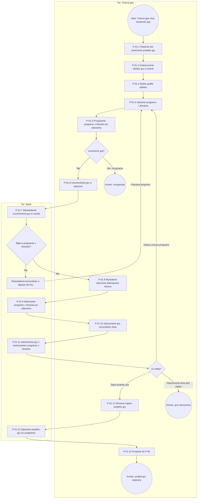

# P-01: Tworzenie i uruchomienie gry (TO-BE)

**Wersja:** 0.1 · **Właściciel:** Bekzhigit · **Powiązane:** P-00 (AS-IS), P-02, P-03

## Cel procesu

Opisać, jak Twórca gier w Silniku otwiera projekt gry, składa program z klocków, uruchamia grę w edytorze i ją zatrzymuje, a następnie zapisuje projekt gry na swoim urządzeniu. Dzięki temu Twórca gier od razu widzi w prawdziwej grze, jak działają jego klocki (N-01, N-05), a praca nie ginie po zatrzymaniu gry (N-04).

## Wyzwalacz (zdarzenie początkowe)

Twórca gier chce zbudować lub dokończyć grę i otwiera aplikację Modde.

## Uczestnicy (tory i pule)

| Tor | Kto | Rola w procesie |
|---|---|---|
| Twórca gier | Osoba, która w Modde układa program z klocków, testuje go i zapisuje projekt gry | Wykonuje kroki użytkownika i kroki ręczne: wybiera, układa, dotyka ekranu, naciska „Stop”, zapisuje |
| Silnik | Mechanizm uruchamiający grę i wyświetlający ją na ekranie | Wyświetla scenę, wykonuje program z klocków po zdarzeniu, zatrzymuje grę, zapisuje projekt gry |

Pula: aplikacja Modde (jedna pula, dwa tory). Słownik definiuje Silnik jako całość aplikacji; w tym procesie tor „Silnik” oznacza wyłącznie część, która uruchamia grę i wyświetla ją na ekranie.

## Wyniki (zdarzenia końcowe)

- **Gra zatrzymana** – gra została uruchomiona i zatrzymana, program z klocków pozostał bez zmian, a Twórca gier kończy test bez zapisu i bez dalszych zmian.
- **Projekt gry zapisany** – projekt gry został zapisany na urządzeniu Twórcy gier i można przejść do P-02.
- **Rezygnacja** – Twórca gier przerywa pracę, zanim uruchomi grę, i nie zapisuje projektu gry.

## Diagram

Diagram BPMN: w przygotowaniu (osobne zadanie).

## Kroki

| Krok | Tor | Typ zadania | Opis | Wymagania |
|---|---|---|---|---|
| P-01.1 Otwarcie lub utworzenie projektu gry | Twórca gier | użytkownika | Twórca gier wczytuje zapisany projekt gry, otwiera jeden z dwóch przykładowych projektów gry albo zaczyna nowy projekt gry. | FR-16, FR-20; utworzenie nowego projektu gry: brak — do walkthrough |
| P-01.2 Umieszczenie obiektu gry w scenie | Twórca gier | użytkownika | Twórca gier umieszcza obiekt gry w scenie projektu gry. | FR-08 |
| P-01.3 Wybór grafiki obiektu | Twórca gier | użytkownika | Twórca gier wybiera grafikę obiektu lub tła z biblioteki grafik. | FR-09 |
| P-01.4 Ułożenie programu z klocków | Twórca gier | użytkownika | Twórca gier dodaje klocki do programu z klocków metodą „przeciągnij i upuść”, m.in. klocki zmiennej, warunku, pętli i położenia, wyłącznie ze stałego zestawu klocków. | FR-01, FR-03, FR-04, FR-05, FR-06, BR-02 |
| P-01.5 Przypisanie programu z klocków do zdarzenia | Twórca gier | użytkownika | Twórca gier przypisuje program z klocków do zdarzenia: początek gry, każda klatka, dotknięcie ekranu, kolizja lub upływ czasu. | FR-02, BR-05 |
| P-01.6 Uruchomienie gry w edytorze | Twórca gier | użytkownika | Twórca gier uruchamia grę bezpośrednio w edytorze, aby zobaczyć działanie programu z klocków. | FR-10 |
| P-01.7 Wyświetlenie uruchomionej gry w scenie | Silnik | usługi | Silnik wyświetla uruchomioną grę z obiektami gry w scenie i sprawdza program z klocków; w razie błędu wyświetla komunikat ze wskazaniem klocka (zob. W-01). | FR-10, FR-13, FR-14 |
| P-01.8 Wywołanie zdarzenia dotknięciem ekranu | Twórca gier | ręczne | Twórca gier dotyka ekranu w uruchomionej grze, co wywołuje zdarzenie. | FR-02 |
| P-01.9 Wykonanie programu z klocków po zdarzeniu | Silnik | usługi | Obiekt gry wykonuje program z klocków dopiero wtedy, gdy wystąpi zdarzenie, do którego go przypisano. | FR-02, FR-10, BR-05 |
| P-01.10 Zatrzymanie gry przyciskiem „Stop” | Twórca gier | użytkownika | Twórca gier naciska przycisk „Stop”, aby zatrzymać uruchomioną grę. | FR-11, NFR-03 |
| P-01.11 Zatrzymanie gry z zachowaniem programu z klocków | Silnik | usługi | Silnik zatrzymuje grę nie później niż 1 sekundę po naciśnięciu przycisku „Stop” i zachowuje program z klocków bez zmian (0 utraconych klocków). | FR-11, NFR-03 |
| P-01.12 Zlecenie zapisu projektu gry | Twórca gier | użytkownika | Twórca gier zleca zapis projektu gry na swoim urządzeniu, bez zakładania konta. | FR-15, BR-03 |
| P-01.13 Zapisanie projektu gry na urządzeniu | Silnik | usługi | Silnik zapisuje projekt gry lokalnie na urządzeniu Twórcy gier. | FR-15, BR-03 |
| P-01.14 Przejście do P-02 | Twórca gier | użytkownika | Po zapisaniu projektu gry Twórca gier przechodzi do procesu P-02. | brak — do walkthrough |

## Wyjątki i ścieżki alternatywne

| Wyjątek | Gdzie | Reakcja | Wymaganie / BR |
|---|---|---|---|
| W-01 Błąd w programie z klocków | P-01.7 | Silnik wyświetla komunikat o błędzie ze wskazaniem klocka, którego błąd dotyczy, w ciągu 2 sekund od uruchomienia gry. Twórca gier wraca do P-01.4 i poprawia program z klocków. | FR-13, NFR-06 |
| W-02 Pętla, która się nie kończy | P-01.9 | Silnik przerywa wykonywanie programu z klocków, w którym pętla nie kończy się w ciągu jednej klatki, bez utraty projektu gry. Twórca gier może też nacisnąć „Stop”; gra zatrzymuje się nie później niż po 1 sekundzie, a liczba klocków pozostaje bez zmian. | FR-12, FR-11, NFR-03 |
| W-03 Program z klocków bez przypisanego zdarzenia | P-01.6, P-01.9 | Obiekt gry nie wykonuje programu z klocków, bo nie wystąpiło zdarzenie, do którego go przypisano. Twórca gier wraca do P-01.5 i przypisuje program z klocków do zdarzenia. | BR-05 |
| W-04 Próba dodania własnego klocka | P-01.4 | Program z klocków nie zawiera własnego klocka; Twórca gier układa program wyłącznie ze stałego zestawu klocków. | BR-02 |
| W-05 Nazwa projektu gry już użyta przy zapisie | P-01.12 | Reakcja Silnika do ustalenia z klientem (zob. Otwarte pytania). | brak — do walkthrough |
| W-06 Rezygnacja przed uruchomieniem gry | po P-01.5 | Twórca gier przerywa pracę, nie uruchamia gry i nie zapisuje projektu gry (zdarzenie końcowe „rezygnacja”). | brak — do walkthrough |

## Zmiany względem AS-IS

| Krok w P-00 (AS-IS) | Co się zmienia w P-01 (TO-BE) |
|---|---|
| 1. Wprowadzenie tematu na lekcji; 2. Rysowanie schematów blokowych | Schemat na tablicy zastępuje uruchomienie gry w edytorze (P-01.6, P-01.7, P-01.9): Twórca gier od razu widzi działanie klocków w grze (N-01, N-05). Prowadzenie lekcji przez nauczyciela leży poza P-01. |
| 3. Układanie własnych poleceń w pracowni | Zastępuje to ułożenie programu z klocków (P-01.4) i przypisanie go do zdarzenia (P-01.5), na telefonie lub komputerze w tej samej aplikacji (FR-01, FR-02, FR-21; NFR-09 dla szkolnych komputerów). Warunek, pętla i zmienna są osobnymi klockami, a efekt widać w grze (N-05). |
| 4. Oglądanie prac w trakcie lekcji | Twórca gier sam widzi efekt na własnym ekranie (P-01.7). Rola nauczyciela nie występuje w P-01, a panel nauczyciela jest poza zakresem projektu (karta projektu, „Zakres OUT”). |
| 5. Zapisanie pracy po lekcji (w P-00: brak informacji) | Zapis staje się zadaniem Silnika: P-01.12 i P-01.13, lokalnie na urządzeniu (FR-15, BR-03). |
| 6. Ćwiczenie w domu | Twórca gier wykonuje wszystkie kroki na telefonie z ekranem dotykowym (FR-01, N-07). Komunikat o błędzie ze wskazaniem klocka zastępuje brak podpowiedzi (W-01, FR-13, N-08). |
| 7. Próba dokończenia pracy w domu | Częściowo: projekt gry zapisany na urządzeniu można wczytać (P-01.1, FR-16). Przeniesienie projektu gry ze szkolnego komputera na telefon nie jest w P-01 rozwiązane (zob. Otwarte pytania, Q-04). |
| 8. Pokazanie pracy koledze lub rodzinie | Poza P-01. Przekazanie gry jako wyeksportowanej gry (FR-17, FR-18) nie jest częścią tego procesu; do potwierdzenia, czy opisuje to P-02 czy P-03. |
| 9. Zbieranie gotowych projektów; 10. Sprawdzenie prac po lekcji | Poza P-01 i poza systemem: Modde nie ma osobnej roli nauczyciela ani panelu nauczyciela (karta projektu, „Zakres OUT”). |

Kroki, które znikają w TO-BE: rysowanie schematów blokowych na tablicy oraz chodzenie po pracowni w celu oglądania prac na ekranach.

## Otwarte pytania

1. Co dokładnie opisują procesy P-02 i P-03 oraz do którego z nich przechodzi P-01.14?
2. Jaki wymóg opisuje utworzenie nowego projektu gry w P-01.1 (brak FR)? Czy potrzebny jest nowy FR?
3. Co powinno się stać, gdy Twórca gier zapisuje projekt gry pod nazwą, której już użył? (Q-11)
4. W jakim stanie powinna zostać gra po użyciu przycisku „Stop”? (Q-02)
5. W jaki sposób Twórca gier ma dokończyć w domu na telefonie pracę zaczętą na szkolnym komputerze? (Q-04)
6. Czy Silnik ma ostrzegać Twórcę gier, gdy program z klocków nie ma przypisanego zdarzenia (W-03)? Obecnie BR-05 mówi tylko, że program się nie wykonuje.
7. Czy zdarzenie końcowe „rezygnacja” (W-06) wymaga osobnego wymagania lub reguły biznesowej?
