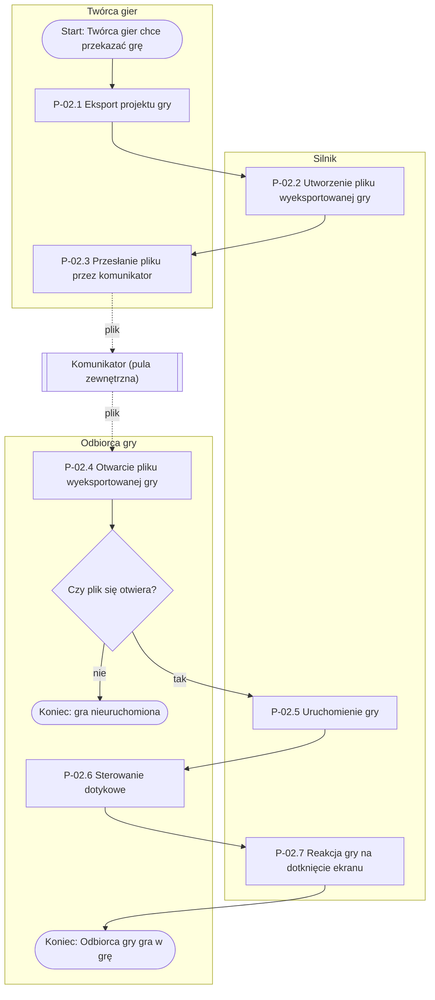

# P-02: Eksport i przekazanie gry (TO-BE)

**Wersja:** 0.1 · **Właściciel:** Temirlan · **Powiązane:** P-00 (AS-IS), P-01

## Cel procesu

Twórca gier przekazuje swoją grę innej osobie tak, aby Odbiorca gry mógł ją uruchomić i zagrać w nią na swoim telefonie, bez możliwości jej zmieniania i bez publikacji w sklepach z aplikacjami (N-11, N-12, BR-01, BR-04).

## Wyzwalacz (zdarzenie początkowe)

Twórca gier ma zapisany projekt gry i chce, aby inna osoba zagrała w jego grę na swoim telefonie (US-08).

## Uczestnicy (tory i pule)

- **Twórca gier** (tor) – eksportuje projekt gry i przesyła plik wyeksportowanej gry.
- **Silnik** (tor) – tworzy plik wyeksportowanej gry, a na telefonie Odbiorcy gry uruchamia grę i reaguje na dotknięcie ekranu.
- **Odbiorca gry** (tor) – otwiera otrzymany plik, uruchamia grę i steruje nią dotykiem.
- **Komunikator** (pula zewnętrzna, zwinięta) – przenosi plik między telefonami poza Silnikiem; jego działania nie opisujemy.

## Wyniki (zdarzenia końcowe)

- **Sukces:** Odbiorca gry uruchamia wyeksportowaną grę na swoim telefonie i steruje nią przez dotknięcie ekranu (FR-18, FR-19).
- **Gra nieuruchomiona:** plik wyeksportowanej gry nie otwiera się na telefonie Odbiorcy gry (zob. W-1).
- **Eksport gry z błędem:** wynik do ustalenia z klientem (zob. W-2, Q-12).

## Diagram

## Kroki

| Krok | Tor | Typ zadania | Opis | Wymagania |
|---|---|---|---|---|
| P-02.1 | Twórca gier | zadanie użytkownika | Twórca gier wybiera eksport zapisanego projektu gry. | FR-17, US-08 |
| P-02.2 | Silnik | zadanie automatyczne | Silnik tworzy plik wyeksportowanej gry na urządzeniu Twórcy gier. | FR-17, BR-04 |
| P-02.3 | Twórca gier | zadanie ręczne | Twórca gier przesyła plik wyeksportowanej gry Odbiorcy gry przez komunikator, poza Silnikiem. | BR-04, NFR-10, US-08 |
| P-02.4 | Odbiorca gry | zadanie użytkownika | Odbiorca gry otwiera otrzymany plik wyeksportowanej gry na swoim telefonie. | FR-18, NFR-08, US-09 |
| P-02.5 | Silnik | zadanie automatyczne | Silnik uruchamia wyeksportowaną grę bez możliwości zmiany programu z klocków. | FR-18, BR-01, BR-04 |
| P-02.6 | Odbiorca gry | zadanie użytkownika | Odbiorca gry steruje grą przez sterowanie dotykowe. | FR-19 |
| P-02.7 | Silnik | zadanie automatyczne | Silnik pokazuje reakcję obiektu gry na dotknięcie ekranu oraz aktualny wynik. | FR-19, FR-14, NFR-01 |

## Wyjątki i ścieżki alternatywne

| ID | Przy kroku | Sytuacja | Co się dzieje | Wymagania |
|---|---|---|---|---|
| W-1 | P-02.4 | Plik wyeksportowanej gry nie otwiera się na innym telefonie. | Gra nie zostaje uruchomiona. Dalsze działanie Odbiorcy gry i Twórcy gier jest do ustalenia (zob. Q-13). | NFR-08; brak — do walkthrough |
| W-2 | P-02.1 | Twórca gier eksportuje grę, w której program z klocków zawiera błąd. | Nie wiadomo, czy Silnik pozwala na eksport takiej gry (zob. Q-12). | brak — do walkthrough |
| W-3 | P-02.5 | Odbiorca gry próbuje zmienić program z klocków otrzymanej gry. | Silnik nie pozwala na zmianę i gra pozostaje taka, jaką przygotował Twórca gier. | BR-01, US-09 |

## Zmiany względem AS-IS

| Krok w P-00 | Stan obecny (AS-IS) | Zmiana w TO-BE |
|---|---|---|
| 7. Próba dokończenia pracy w domu | Uczeń wysyła plik pocztą lub komunikatorem, a plik często nie otwiera się tak, jak powinien (N-10, N-11). | P-02 przekazuje tylko wyeksportowaną grę do zagrania. Dalsza praca nad projektem gry na innym urządzeniu jest opisana w P-03. |
| 8. Pokazanie pracy koledze lub rodzinie | Uczeń woła kolegów do swojego ekranu albo wysyła plik, który nie zawsze się otwiera; kolega nie wie, co jest jego postacią (N-11, N-12). | Twórca gier przesyła plik wyeksportowanej gry, a Odbiorca gry uruchamia ją na swoim telefonie (FR-18, NFR-08) i od razu steruje nią przez dotknięcie ekranu (FR-19). |
| 9. Zbieranie gotowych projektów | Nauczyciel zbiera projekty na pendrive'ach lub przez pocztę, część prac się gubi lub nie otwiera. | P-02 nie zmienia sposobu zbierania prac. Czy Nauczyciel ma otrzymywać wyeksportowaną grę tą samą drogą: brak — do walkthrough. |

## Otwarte pytania

| Nr | Pytanie | Powiązanie |
|---|---|---|
| Q-12 | Co powinno się stać, gdy uczeń próbuje przekazać dalej grę, w której program zawiera błąd? (US-08) | W-2, P-02.1 |
| Q-13 | Co musi mieć na telefonie kolega, aby otworzyć grę wysłaną przez ucznia? (US-09) | W-1, P-02.4 |
