# Kontekst systemu (C4, poziom 1) – Modde

**Wersja:** 0.2

## Diagram

```mermaid
flowchart LR
    tworca["Twórca gier<br/>[osoba]"]
    odbiorca["Odbiorca gry<br/>[osoba]"]
    modde["Modde<br/>[system]"]
    komunikator["Komunikator<br/>[system zewnętrzny]"]
    os["System operacyjny urządzenia<br/>(Android, Windows)<br/>[system zewnętrzny]"]

    tworca -->|"układa program z klocków i uruchamia grę"| modde
    tworca -->|"przesyła plik wyeksportowanej gry i plik projektu gry"| komunikator
    komunikator -->|"dostarcza plik wyeksportowanej gry"| odbiorca
    odbiorca -->|"uruchamia wyeksportowaną grę i steruje nią dotykiem"| modde
    modde -->|"zapisuje i odczytuje pliki projektu gry"| os

    classDef osoba fill:#08427b,color:#ffffff,stroke:#052e56
    classDef system fill:#1168bd,color:#ffffff,stroke:#0b4884
    classDef zewnetrzny fill:#8a8a8a,color:#ffffff,stroke:#5c5c5c
    class tworca,odbiorca osoba
    class modde system
    class komunikator,os zewnetrzny
```

## Elementy

| Element | Typ | Opis | Właściciel |
|---|---|---|---|
| Twórca gier | osoba | Osoba, która w Modde układa program z klocków, testuje go i eksportuje własną grę. | — |
| Odbiorca gry | osoba | Osoba, która otrzymuje gotową grę od Twórcy gier i uruchamia ją na swoim telefonie, bez możliwości jej zmieniania. | — |
| Modde | system | Silnik do układania programu gry z klocków, uruchamiania gry, zapisu projektu gry i eksportu gry do pliku. | zespół projektu |
| Komunikator | system zewnętrzny | Aplikacja, przez którą Twórca gier przesyła plik wyeksportowanej gry Odbiorcy gry lub plik projektu gry na inne urządzenie. | poza Silnikiem, bez integracji (P-02.3, P-03.4) |
| System operacyjny urządzenia | system zewnętrzny | Android na telefonie lub Windows na komputerze; przechowuje pliki projektu gry i pliki wyeksportowanej gry na urządzeniu. | poza Silnikiem, dostawca systemu operacyjnego |

Elementy zakresu OUT (konta użytkowników, sklep z aplikacjami, platforma udostępniania gier) celowo nie występują na diagramie.
