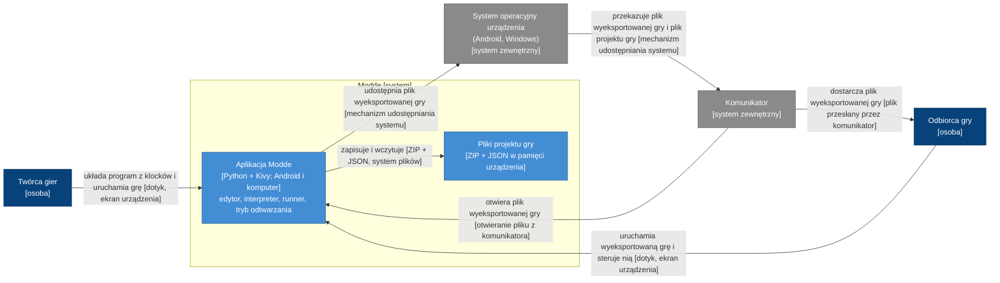

# Kontenery (C4, poziom 2) — Modde

**Wersja:** 0.1

## Diagram

Edytor, interpreter, runner i `storage/` (zapis i eksport) są modułami (komponentami, zajęcia 12) jednej aplikacji, a nie osobnymi kontenerami (ADR-002).

## Kontenery

| Kontener | Technologia | Odpowiedzialność | Wymagania |
|---|---|---|---|
| Aplikacja Modde | Python, Kivy; pakowanie: Buildozer (Android), PyInstaller (wersja przenośna na komputer); do potwierdzenia prototypem (ADR-003) | Układanie programu z klocków i umieszczanie obiektów gry w scenie (edytor), wykonywanie programu z klocków po wystąpieniu zdarzenia i zatrzymanie gry przyciskiem „Stop” (interpreter), rysowanie sceny, sterowanie dotykowe i wyświetlanie wartości zmiennej (runner), tryb odtwarzania wyeksportowanej gry bez możliwości zmiany programu z klocków, zapis, wczytanie i eksport projektu gry (`storage/`). Moduły komunikują się przez format opisany w `contract/`. | FR-01–FR-14, FR-17–FR-19, FR-21, FR-22, BR-01, BR-02, BR-05, NFR-02, NFR-03, NFR-05, NFR-07, NFR-09, NFR-10 |
| Pliki projektu gry | ZIP + JSON w pamięci urządzenia; schemat z polem wersji formatu; wyeksportowana gra: osobne rozszerzenie i znacznik „tylko do odczytu” (`make-or-buy.md`); do potwierdzenia prototypem (ADR-003) | Przechowywanie na urządzeniu nazwy, scen, obiektów gry, programu z klocków i grafik jako projektu gry lub wyeksportowanej gry. Zapis wyłącznie lokalnie, bez kont użytkowników. Znacznik „tylko do odczytu” nie blokuje zmian sam z siebie; zakaz zmiany programu z klocków egzekwuje tryb odtwarzania w aplikacji. | FR-15, FR-16, FR-17, FR-23, BR-01, BR-03, BR-04, NFR-08, NFR-10 |

## Wpływ NFR na architekturę

| NFR | Wymaganie (skrót) | Odpowiedź architektoniczna |
|---|---|---|
| NFR-02 | Średnio co najmniej 30 klatek na sekundę w scenie z 50 obiektami gry na telefonie z Androidem z 3 GB pamięci RAM. | Runner rysuje scenę w Kivy na urządzeniu, a całe wykonywanie gry odbywa się lokalnie w aplikacji, bez serwera (ADR-002). Wydajność Kivy na słabym telefonie: do potwierdzenia prototypem (ADR-003). |
| NFR-03 | Zatrzymanie gry po naciśnięciu „Stop” w czasie nie dłuższym niż 1 sekunda, także przy pętli, która się nie kończy, i 0 utraconych klocków. | Interpreter wykonuje program z klocków porcjami w każdej klatce i po każdej porcji sprawdza, czy naciśnięto „Stop”. Pętla, która się nie kończy, jest więc przerywana na granicy porcji, a program z klocków pozostaje bez zmian. Czas zatrzymania na telefonie: do potwierdzenia prototypem (ADR-003). |
| NFR-07 | Edytor wyświetla się w całości na ekranach telefonów o przekątnej od 5,0 do 6,7 cala, w orientacji pionowej i poziomej. | Układ ekranu edytora w Kivy przygotowujemy sami, z uwzględnieniem rozmiaru ekranu i orientacji. Zachowanie na ekranach 5,0–6,7 cala: do potwierdzenia prototypem (ADR-003). |
| NFR-08 | Wyeksportowana gra otwiera się i uruchamia na innym telefonie z Androidem w 10 z 10 prób po przesłaniu przez komunikator. | Wyeksportowana gra jest jednym plikiem, który zawiera grafiki oraz wersję formatu, więc nie zależy od zasobów urządzenia, na którym ją utworzono. Otwarcie pliku bezpośrednio z komunikatora w Modde: do potwierdzenia prototypem (ADR-003). |
| NFR-09 | Uruchomienie na komputerze bez uprawnień administratora, z zablokowaną instalacją, w nie więcej niż 3 czynnościach. | Wersja na komputer jest wersją przenośną budowaną przez PyInstaller, bez instalacji. Brak blokady przez szkolne zabezpieczenia: do potwierdzenia prototypem (ADR-003) i w pracowni szkolnej. |
| NFR-10 | 0 bajtów danych Twórcy gier wysłanych poza urządzenie w ciągu 30 minut użytkowania. | Aplikacja nie ma modułu sieciowego ani uprawnienia do Internetu na Androidzie. Plik wyeksportowanej gry przesyła Twórca gier przez Komunikator poza aplikacją, bez integracji. Brak uprawnienia do Internetu w pliku instalacyjnym zbudowanym przez Buildozer: do potwierdzenia prototypem (ADR-003). |
