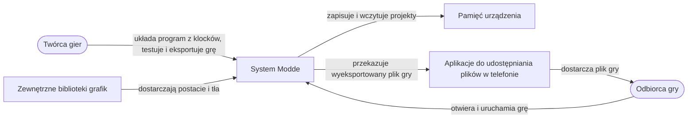

# Diagram kontekstu

System Modde pokazany jako jedna całość, z rolami użytkowników i elementami zewnętrznymi, z którymi wymienia informacje.

````markdown

````

## Opis

| Element | Rola w diagramie |
|---|---|
| Twórca gier | Układa program z klocków, testuje grę i eksportuje ją. |
| Odbiorca gry | Otrzymuje plik gry od twórcy i uruchamia go. |
| Pamięć urządzenia | Miejsce, w którym system zapisuje projekty lokalnie. |
| Aplikacje do udostępniania plików | Komunikatory, poczta i inne aplikacje telefonu, którymi wysyła się plik gry (nie są częścią systemu). |
| Zewnętrzne biblioteki grafik | Źródło gotowych postaci i teł na otwartych licencjach. |

## Zgodność z zakresem

Diagram nie zawiera elementów z zakresu OUT (konta, platforma udostępniania gier, publikacja w sklepie z aplikacjami).